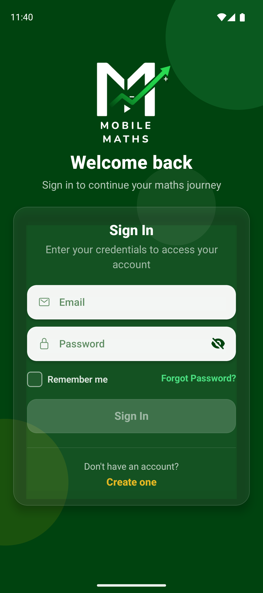
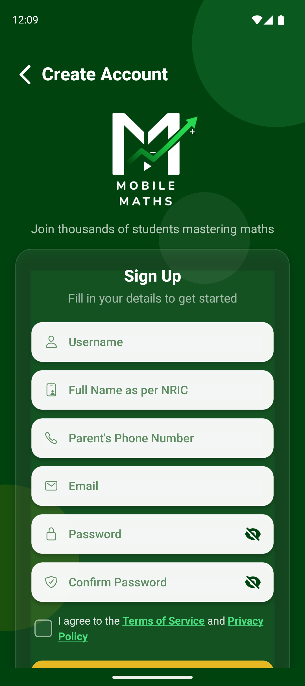
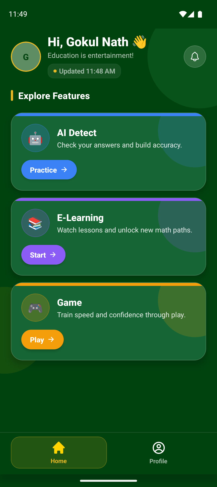
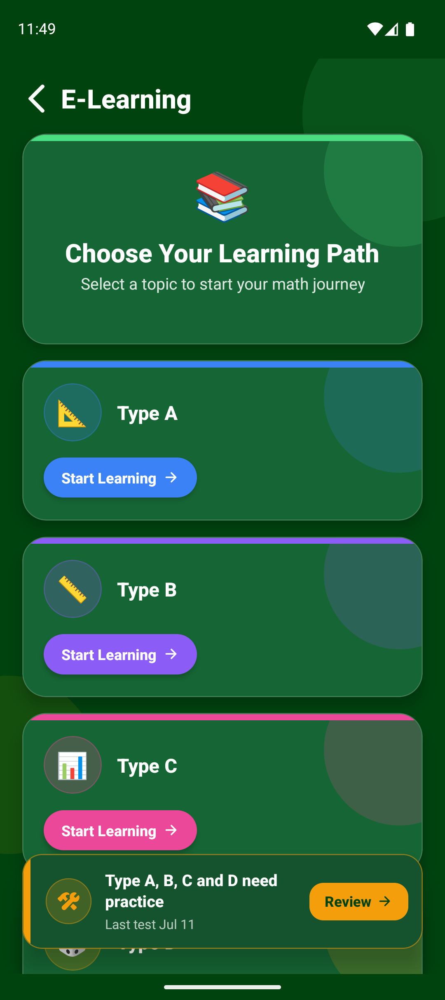
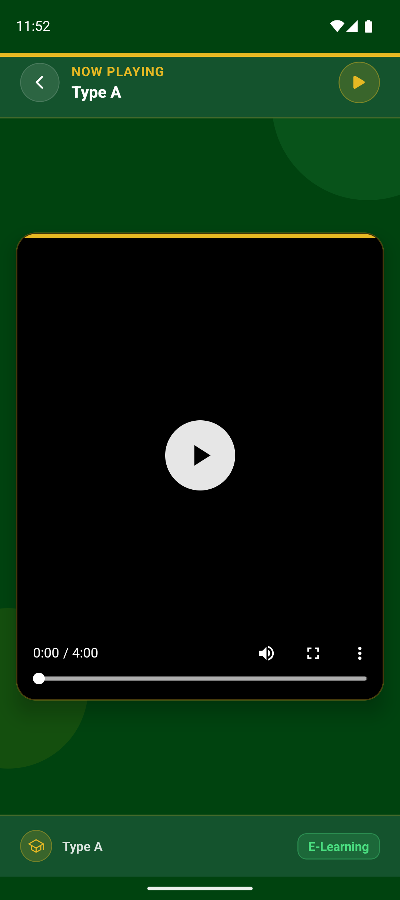
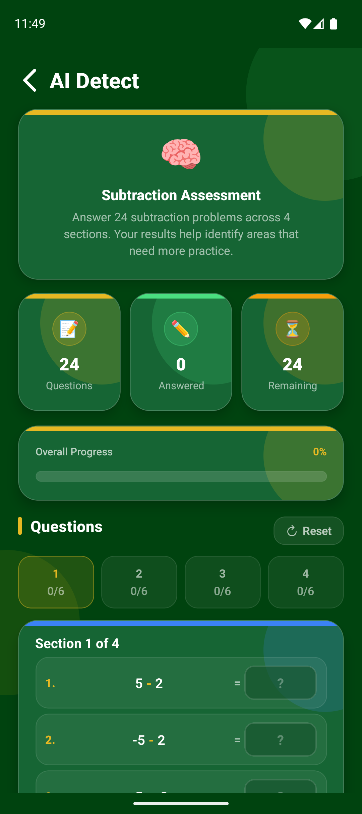
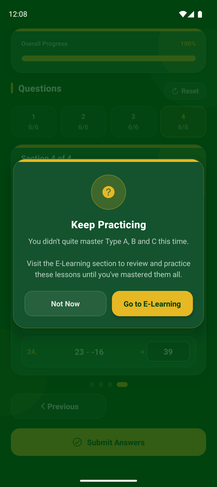
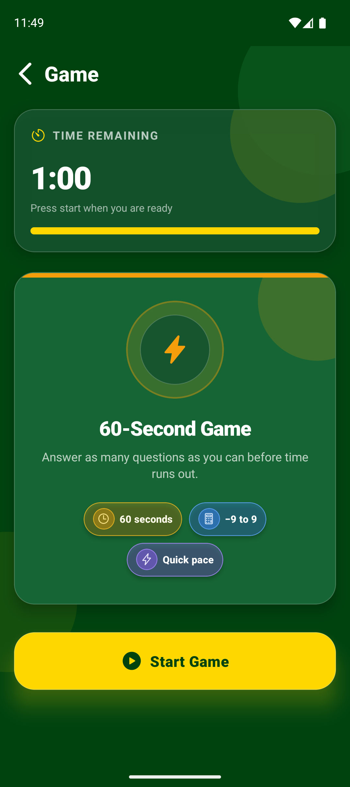
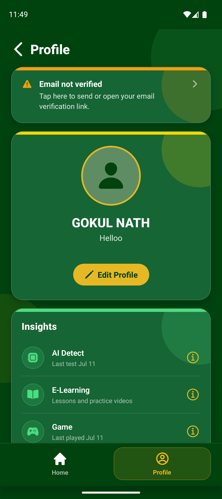

# 📱 MobileMaths

**A mobile app that helps students find and fix the gaps in their maths.**

---

## About

MobileMaths gives students a short test, works out which kinds of questions they get wrong, and then points them to video lessons for exactly those topics. A timed maths game keeps practice fun.

> This repository is a portfolio showcase. The app's source code is private.

## What it does

- 🎯 **Finds weak spots** with a 24-question test
- 📚 **Recommends video lessons** that match the results
- ⚡ **Builds speed** with a 60-second maths game
- 👤 **Tracks progress** on the student's profile
- 💳 **Offers subscriptions** paid in-app

---

## Screens

### Getting started

<table>
  <tr>
    <td align="center" width="50%">
       
      <b>Sign In</b> 
      Log in with email and password.
    </td>
    <td align="center" width="50%">
       
      <b>Create Account</b> 
      Sign up with a few details and accept the terms.
    </td>
  </tr>
</table>

### Home and learning

<table>
  <tr>
    <td align="center" width="33%">
       
      <b>Home</b> 
      Shortcuts to the three main features.
    </td>
    <td align="center" width="33%">
       
      <b>E-Learning</b> 
      Pick a topic and see which ones need practice.
    </td>
    <td align="center" width="33%">
       
      <b>Video Lesson</b> 
      Watch a lesson, online or downloaded.
    </td>
  </tr>
</table>

### Test and practice

<table>
  <tr>
    <td align="center" width="33%">
       
      <b>AI Detect</b> 
      Answer 24 subtraction questions in 4 sections.
    </td>
    <td align="center" width="33%">
       
      <b>Results</b> 
      See which topics to practise next.
    </td>
    <td align="center" width="33%">
       
      <b>Speed Game</b> 
      Answer as many as you can in 60 seconds.
    </td>
  </tr>
</table>

### Profile

<table>
  <tr>
    <td align="center" width="50%">
       
      <b>Profile</b> 
      Recent activity for each feature, plus account settings.
    </td>
    <td width="50%"></td>
  </tr>
</table>

---

## Built with

React Native · TypeScript · Firebase · Zustand · HitPay

More detail is in the [`docs`](docs/) folder.

---

**Gokul Nath** · [GitHub @GokulNath20](https://github.com/GokulNath20)

