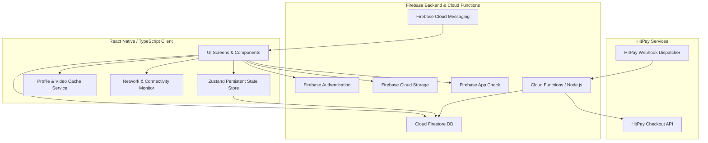

# 📱 MobileMaths — Educational Math Learning & Diagnostic Platform

[](https://reactnative.dev/)
[](https://www.typescriptlang.org/)
[-FFCA28?logo=firebase)](https://firebase.google.com/)
[](https://github.com/pmndrs/zustand)
[](https://hitpayapp.com/)

> **Portfolio Showcase**: MobileMaths is a full-featured cross-platform mobile application developed for an educational technology service. The platform delivers diagnostic assessment, adaptive remedial video learning, gamified speed math drills, and subscription management.
>
> *Note: This repository contains architectural documentation, system design notes, and feature showcases for portfolio presentation. Source code remains proprietary.*

---

## 📑 Table of Contents
- [Executive Overview](#-executive-overview)
- [Key Features](#-key-features)
- [System Architecture](#-system-architecture)
- [Feature Deep Dive](#-feature-deep-dive)
  - [1. AI Diagnostic Assessment](#1-ai-diagnostic-assessment)
  - [2. Personalized Adaptive E-Learning](#2-personalized-adaptive-e-learning)
  - [3. Gamified Speed Math Drills](#3-gamified-speed-math-drills)
  - [4. Subscription & Payment Engine](#4-subscription--payment-engine)
  - [5. Device Binding & Multi-Tier Security](#5-device-binding--multi-tier-security)
  - [6. Real-Time Notification Center](#6-real-time-notification-center)
  - [7. Offline Resilience & Caching](#7-offline-resilience--caching)
- [App Showcase & UI Screenshots](#-app-showcase--ui-screenshots)
- [Tech Stack & Engineering Highlights](#-tech-stack--engineering-highlights)
- [Automated Testing & QA Matrix](#-automated-testing--qa-matrix)
- [Documentation Index](#-documentation-index)

---

## 🎯 Executive Overview

MobileMaths was engineered to bridge foundational gaps in student mathematics through an automated diagnostic-to-remediation loop. Rather than delivering generic video lessons, the app diagnoses specific cognitive failure patterns in arithmetic rules, maps them to targeted video modules, and reinforces mastery with gamified, timed math drills.

### Core Value Pillars
1. **Targeted Remediation**: Evaluates specific signed integer arithmetic misconceptions (Types A–D) with an interactive 24-question diagnostic tool.
2. **Personalized Video Delivery**: Directs students to remedial video lessons specifically matching their detected weak spots, with offline video downloading and local caching.
3. **Engaging Gamification**: High-tempo 60-second math drills with real-time answer evaluation, streak tracking, XP accrual, leveling, and historical session logs.
4. **Commercial-Ready Monetization**: Seamless multi-channel subscription checkout (PayNow QR, Cards, e-Wallets) via HitPay with resilient abandoned-cart handling and webhook validation.

---

## 🌟 Key Features

```
┌─────────────────────────────────────────────────────────────────────────────┐
│                              MobileMaths Platform                           │
├───────────────────┬───────────────────┬───────────────────┬─────────────────┤
│ 🎯 Diagnostic     │ 📚 E-Learning     │ ⚡ Gamification    │ 💳 Commercial   │
│ • 4 Math Types    │ • Targeted Videos │ • 60s Timed Drill │ • HitPay PayNow │
│ • Error Profiling │ • Local FS Cache  │ • XP & Leveling   │ • Cloud Webhook │
│ • Auto-Assignment │ • Progress Track  │ • Dynamic Streaks │ • Device Binding│
└───────────────────┴───────────────────┴───────────────────┴─────────────────┘
```

- **Smart Diagnostic Engine**: Pinpoints arithmetic rule breakdown across positive and negative integer operations.
- **Custom Video Player**: Seamless landscape/portrait auto-orientation, scrubbing, offline file caching via `react-native-fs`.
- **Speed Math Arena**: Real-time evaluation with auto-advancing input, celebratory animations, and dynamic XP calculations.
- **HitPay Gateway Integration**: Multi-tier subscription billing with Cloud Functions, webhook signature authentication, and mobile-driven QR checkout timeout listeners.
- **Single-Device Subscription Binding**: Hardware fingerprinting to prevent unauthorized multi-device subscription sharing.
- **Zero-Flicker Image & Data Caching**: Multi-level avatar and video caching to ensure instant rendering even over low-bandwidth connections.
- **Offline Safeguards**: Network detection interceptors that preserve UX continuity and gracefully degrade offline interactions.

---

## 🏗 System Architecture

The client architecture follows a modular, reactive design built on **React Native 0.85**, **React 19**, and **TypeScript**, integrated with a serverless **Firebase** ecosystem.



---

## 🔍 Feature Deep Dive

### 1. AI Diagnostic Assessment
- **Assessment Structure**: 24 structured arithmetic questions divided into 4 difficulty/logic categories:
  - **Type A**: Standard subtraction & basic integer rules (\(a - b\))
  - **Type B**: Negative minuend subtraction (\(-a - b\))
  - **Type C**: Subtraction with negative subtrahend (\(a - (-b)\))
  - **Type D**: Double negative operations (\(-a - (-b)\))
- **Diagnostic Engine**: Analyzes response accuracy per type; if any question within a type is missed, the type is flagged as requiring remediation.
- **Immediate Feedback**: Generates detailed breakdown with instant navigation to personalized remedial video lessons.

### 2. Personalized Adaptive E-Learning
- **Dynamic Content Mapping**: Highlights specific recommended video modules based on recent diagnostic results.
- **Offline Video Engine**: Built-in download manager using `react-native-fs` that downloads instructional MP4 files from Firebase Storage to local device storage for offline playback.
- **Video Player**: Custom video playback component with auto-orientation transitions, resume timestamps, and watch history tracking.

### 3. Gamified Speed Math Drills
- **60-Second Challenge**: Fast-paced math problem generation with instant feedback loops.
- **Smart Input Parsing**: Sanitizes negative numbers and auto-submits upon valid length detection for high throughput.
- **XP & Progression System**:
  $$\text{XP Earned} = \text{Correct Answers} \times \text{Multiplier} + \text{Streak Bonus}$$
- **Session History**: Detailed logs stored in Cloud Firestore displaying timestamps, question breakdown, and accuracy metrics in user profiles.

### 4. Subscription & Payment Engine
- **HitPay Checkout Integration**: In-app webview integration for Singapore/Southeast Asian payment methods (PayNow QR, Credit Cards, e-Wallets).
- **Resilient Webhook Pipeline**: Cloud Functions verify `Hitpay-Signature` using per-webhook HMAC salts.
- **Abandoned Checkout Recovery**: 10-minute Firestore transaction watcher that monitors QR checkout states and expires abandoned transactions without blocking late payment reconciliations.

### 5. Device Binding & Multi-Tier Security
- **Hardware Binding**: Locks active subscriptions to verified device identifiers (`react-native-device-info`), preventing subscription reuse across unauthorized devices.
- **Firebase App Check**: Protects backend resources and Firestore rules against abuse with Play Integrity (Android) and DeviceCheck (iOS).
- **Native Auth Lifecycle**: Manages email verification states with resend cooldown timers and secure credential reset flows.

### 6. Real-Time Notification Center
- **Push & In-App Alerts**: Firebase Cloud Messaging integration for system announcements, learning reminders, and subscription notices.
- **Filterable Notification Hub**: Categorized tabs (All, System, Learning, Subscriptions) with read/unread tracking and badge indicators.

### 7. Offline Resilience & Caching
- **Network Interceptors**: Real-time NetInfo monitoring with non-intrusive alert toasts and offline navigation guards.
- **Profile Photo Priming**: Custom local cache layer that downloads and caches avatars locally to eliminate screen flashing.

---

## 📸 App Showcase & UI Screenshots

> *Replace the placeholder images below with actual application screenshots in the `./screenshots/` directory.*

### 🔐 Authentication & Onboarding
| 1. Sign In & Security | 2. Registration & Validation | 3. Email Verification |
| :---: | :---: | :---: |
| <br><sub>*Custom credentials & validation*</sub> | <br><sub>*Form validation & legal terms*</sub> | <br><sub>*Cooldown timer & link dispatch*</sub> |

---

### 🏠 Dashboard & Learning Hub
| 4. Student Dashboard | 5. Personalized Remediation | 6. Video Learning Player |
| :---: | :---: | :---: |
| <br><sub>*XP level, streak & shortcuts*</sub> | <br><sub>*Diagnostic-based recommendations*</sub> | <br><sub>*Orientation sync & offline caching*</sub> |

---

### ⚡ Gamification & Diagnostics
| 7. AI Diagnostic Assessment | 8. Diagnostic Analysis | 9. Speed Math Drill |
| :---: | :---: | :---: |
| <br><sub>*24-Question rule-based testing*</sub> | <br><sub>*Weakness identification breakdown*</sub> | <br><sub>*60s countdown, XP & streak*</sub> |

---

### 💳 Subscriptions & Profile
| 10. Subscription Plans | 11. HitPay QR Checkout | 12. Profile & Activity Log |
| :---: | :---: | :---: |
| <br><sub>*Tiered access & benefits*</sub> | <br><sub>*PayNow QR & Card gateway*</sub> | <br><sub>*Session history & stats*</sub> |

---

## 💻 Tech Stack & Engineering Highlights

### Mobile Client
| Category | Technology | Purpose |
| :--- | :--- | :--- |
| **Framework** | `React Native 0.85` / `React 19` | High-performance native cross-platform core |
| **Language** | `TypeScript 6` | Strict type safety and maintainable domain models |
| **State Management** | `Zustand 5` + `AsyncStorage` | Lightweight persisted store with zero boilerplate |
| **Navigation** | `React Navigation 7` | Native stack and custom animated bottom tabs |
| **Video & Media** | `react-native-video` + `react-native-fs` | Custom streaming, controls, and local disk cache |
| **Hardware & Devices** | `react-native-device-info` | Hardware fingerprinting for device binding |
| **Styling & Layout** | `react-native-responsive-dimensions` | Adaptive typography and orientation management |

### Cloud & Backend Services
| Category | Technology | Purpose |
| :--- | :--- | :--- |
| **Authentication** | `Firebase Auth` | Email/password, verification tokens, security policies |
| **Database** | `Cloud Firestore` | Real-time user profiles, diagnostic logs, session history |
| **Cloud Functions** | `Node.js` (Firebase 2nd Gen) | HitPay checkout generation, webhook parsing, refunds |
| **Cloud Storage** | `Firebase Storage` | Secure delivery of remedial lesson video assets |
| **Notifications** | `Firebase Cloud Messaging` | Push notifications and in-app event dispatch |
| **Integrity** | `Firebase App Check` | DeviceCheck & Play Integrity token enforcement |

---

## 🧪 Automated Testing & QA Matrix

The application includes a comprehensive **57-test-case QA suite** configured for **Firebase App Distribution** and the **Firebase App Testing Agent**:

```
├── 🔐 Auth & Account Suite (14 Tests)
│   ├── Login, Signup validation, Email Verification flows
│   ├── Remember-me token storage, Password Reset cycles
│   └── Account deletion & legal terms acceptance
├── 🏠 Dashboard & Navigation Suite (8 Tests)
│   ├── Responsive tab switching, Avatar preview modal
│   └── Pull-to-refresh synchronization & network toasts
├── 🎯 Diagnostic & Remediation Suite (10 Tests)
│   ├── Multi-section question input & validation
│   └── Weakness categorization (Types A–D) to video mapping
├── ⚡ Speed Math Arena Suite (9 Tests)
│   ├── Timer countdown, auto-submit logic, XP formula verification
│   └── Session recording to Cloud Firestore
├── 💳 Payment & Device Security Suite (10 Tests)
│   ├── Subscription plan selection, HitPay webview loading
│   └── Device binding enforcement and transaction expiration
└── 📡 System & Deep Link Suite (6 Tests)
    ├── Offline route interceptors & recovery
    └── Deep links (email-verified, payment-return)
```

---

## 📚 Documentation Index

For detailed engineering deep-dives, please explore the `/docs` directory:
- [System Architecture & State Flow](docs/ARCHITECTURE.md)
- [Comprehensive Features Overview](docs/FEATURES_OVERVIEW.md)
- [HitPay Payment & Security Implementation](docs/PAYMENT_AND_SECURITY.md)
- [Mathematical Diagnostic Engine & Taxonomy](docs/DIAGNOSTIC_AND_LEARNING_ENGINE.md)
- [Screenshot Guide & Asset Specifications](screenshots/README.md)

---

## 👤 Author & Portfolio

**Gokul Nath**  
- GitHub: [@GokulNath20](https://github.com/GokulNath20)  
- Project: [MobileMaths Showcase](https://github.com/GokulNath20/MobileMaths-MobileApp)  

*Crafted with precision for modern mobile learning.*
