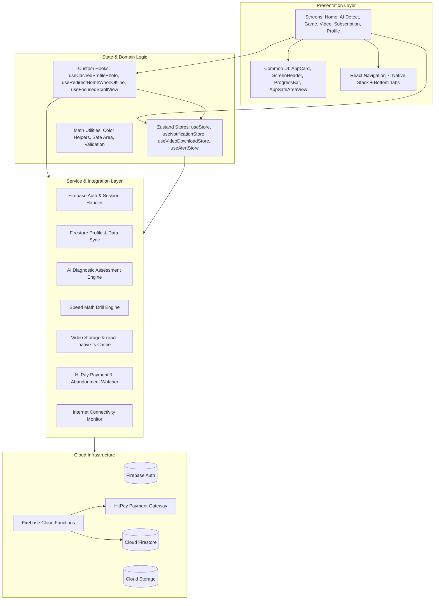

# System Architecture & Technical Design

## 🏛 Overview

MobileMaths is architected around a reactive, modular, and offline-resilient pattern. The client application utilizes **React Native** with **TypeScript**, decoupling UI components from business logic through dedicated service modules, custom hooks, and Zustand state slices.

---

## 📐 Architecture Diagram



---

## 🗃 State Management Architecture

The application uses **Zustand 5** configured with persistence middleware (`AsyncStorage`) and dedicated action creators for predictable state transitions and minimal re-render overhead.

### 1. `useStore` (Global App & User State)
- **User Profile**: `uid`, `email`, `username`, `fullName`, `photoURL`, `emailVerified`, `subscription`, `xp`, `level`, `deviceInfo`.
- **Diagnostic Results**: Cache for latest 24-question assessment breakdown and failed type tags.
- **Activity & Learning**: `lastWatchedVideo`, `questionArray` (history of completed speed math drill sessions).
- **Session Lifecycle**: Verification cooldown timestamps, login draft preservation, and session cleanup.

### 2. `useNotificationStore`
- **Notification Queue**: List of fetched notifications with `id`, `title`, `message`, `type`, `createdAt`, `read`.
- **Filter State**: Active tab filter (`all`, `system`, `learning`, `subscription`).
- **Unread Counter**: Reactive selector for real-time badge updates across bottom tabs and dashboard headers.

### 3. `useVideoDownloadStore`
- **Offline Video Tracking**: Map of downloaded video files, local filesystem paths (`file://...`), and download progress percentages.
- **Cache Invalidation**: Storage verification utilities to ensure files exist on disk before playback.

### 4. `useAlertStore`
- **Global In-App Alert System**: Decoupled banner and modal alerts for network drops, validation errors, and confirmation dialogs.

---

## ⚡ Caching Strategies

To ensure low latency and high reliability in spotty mobile network environments:

| Cache Layer | Mechanism | Purpose |
| :--- | :--- | :--- |
| **Profile Photos** | `profilePhotoCache.ts` + `useCachedProfilePhoto` | Downloads avatar image to local filesystem cache on initial mount; eliminates image flicker on subsequent renders. |
| **Lesson Videos** | `videoStorageService.ts` + `react-native-fs` | Downloads high-definition MP4 instructional videos from Firebase Storage to local sandboxed app directories for offline playback. |
| **User Profile & State** | `zustand/middleware/persist` | Persists user profile, subscription status, and XP locally to allow instant app hydration before network sync. |
| **Network Status** | `@react-native-community/netinfo` | Global subscription tracking reachability; automatically flags offline state without blocking offline-capable screens. |

---

## 📱 Navigation & Routing Hierarchy

The navigation tree is managed by **React Navigation 7** using a dynamic authentication gate:

```
RootNavigator
│
├── 🔐 Unauthenticated / Unverified Flow
│   ├── LoginScreen
│   ├── SignUpScreen
│   ├── ForgotPasswordScreen
│   ├── ResetPasswordScreen
│   ├── VerifyEmailScreen
│   ├── PaymentScreen
│   ├── SubscriptionScreen
│   ├── TermsOfServiceScreen
│   └── PrivacyPolicyScreen
│
└── 🔓 Authenticated & Verified App Flow (MainWithSafeArea)
    ├── MainTabs (Bottom Tab Navigator)
    │   ├── HomeScreen (Dashboard, XP Level, Shortcuts)
    │   └── ProfileScreen (Metrics, Activity History, Settings)
    │
    ├── AIDetectScreen (24-Question Diagnostic Assessment)
    ├── PersonalizedLearningScreen (Targeted Video Modules)
    ├── VideoPlayerScreen (Custom Video Player & Fullscreen)
    ├── GameScreen (60-Second Timed Speed Math Arena)
    ├── NotificationsScreen (Notification Center & Filters)
    ├── EditProfileScreen (User Details & Password Change)
    ├── SubscriptionScreen (Subscription Management)
    └── PaymentScreen (HitPay Checkout WebView)
```
