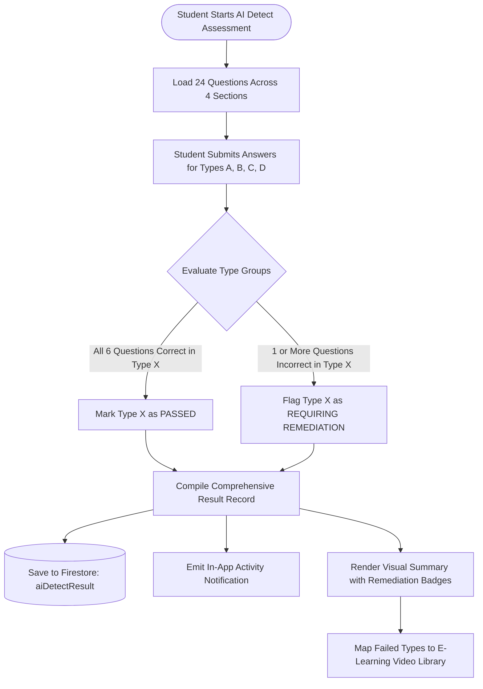

# Mathematical Diagnostic Engine & Remediation Taxonomy

## 🎯 Educational Problem Formulation

Middle-school and secondary-school mathematics students frequently struggle with foundational negative number operations (integer arithmetic). These misconceptions often stem from specific cognitive confusion between subtraction operators and negative sign modifiers.

MobileMaths breaks down integer subtraction into **four distinct mathematical types** to isolate and diagnose the exact conceptual gap.

---

## 📊 Integer Arithmetic Taxonomy

| Type | Formal Representation | Example Problem | Core Misconception Diagnosed |
| :---: | :--- | :--- | :--- |
| **Type A** | \(a - b\) where \(a > 0, b > 0\) | `5 - 2`, `13 - 8`, `16 - 23` | Basic subtraction and transitioning across zero when \(b > a\). |
| **Type B** | \(-a - b\) where \(a > 0, b > 0\) | `-5 - 2`, `-13 - 8`, `-16 - 23` | Failing to recognize that subtracting from a negative number moves further negative (\(-a - b = -(a + b)\)). |
| **Type C** | \(a - (-b)\) where \(a > 0, b > 0\) | `5 - (-2)`, `13 - (-8)`, `16 - (-23)` | Misunderstanding the "double negative" rule turning into addition (\(a - (-b) = a + b\)). |
| **Type D** | \(-a - (-b)\) where \(a > 0, b > 0\) | `-5 - (-2)`, `-13 - (-8)`, `-16 - (-23)` | Complex combined rule where a negative starting value is added to a positive value (\(-a + b\)). |

---

## ⚙️ Diagnostic Assessment Algorithm

---

## 🎓 Adaptive Video Remediation Mapping

Once the diagnostic test completes:
1. The app flags the student's `failedTypes` array (e.g., `['B', 'D']`).
2. The user is presented with a clear explanation: *"We recommend practicing Type B and Type D"*.
3. Navigating to the **Personalized Learning** screen dynamically prioritizes the corresponding video lessons:
   - **Type A Module**: Foundations of Integer Subtraction
   - **Type B Module**: Navigating Negative Starting Values
   - **Type C Module**: Mastering the Double Negative Transformation
   - **Type D Module**: Complex Signed Arithmetic Combinations
4. Students can watch videos with instant orientation controls, or download them to disk for offline revision.
