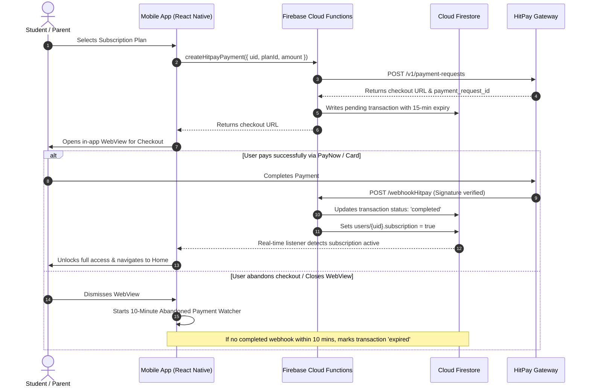

# Payment Gateway Integration & Device Security

## 💳 HitPay Payment Architecture

MobileMaths integrates **HitPay Payment Gateway** to support Southeast Asian regional payment channels (PayNow QR, FPX, Credit/Debit Cards, e-Wallets).

### Payment Lifecycle Flow



---

## 🛡 Abandoned Checkout Handling (QR & PayNow)

Dynamic QR payments (such as PayNow or DuitNow) cannot be programmatically canceled via API once generated. MobileMaths implements a dual-layer resolution strategy:

1. **Pending Status Initialization**:
   - Each transaction begins in `pending` state with a `paymentWindowExpiresAt` timestamp (now + 15 minutes).
2. **Client-Side 10-Minute Watcher**:
   - When the user exits the checkout WebView or foregrounds the app, a temporary 10-minute Firestore listener monitors the transaction.
   - If no `payment_request.completed` webhook arrives before the timeout, the mobile app marks the record as `status: 'expired'`, `failureReason: 'abandoned'`.
3. **Late-Payment Grace Mechanism**:
   - If the student pays in their banking application after the mobile watcher expires the transaction, the Cloud Function webhook handler still accepts and processes `payment_request.completed` webhooks, activating the subscription and updating the status to `completed`.

---

## 🔐 Webhook Authentication & Security

```javascript
// Verification Mechanism in Firebase Cloud Functions
const crypto = require('crypto');

function verifyHitpaySignature(payload, signatureHeader, webhookSalt) {
  const hmac = crypto.createHmac('sha256', webhookSalt);
  hmac.update(payload);
  const calculatedSignature = hmac.digest('hex');
  return crypto.timingSafeEqual(
    Buffer.from(calculatedSignature, 'utf8'),
    Buffer.from(signatureHeader, 'utf8')
  );
}
```

- **Per-Webhook Salt**: Uses the unique per-webhook endpoint salt rather than the standard API key salt to validate the `Hitpay-Signature` header.
- **Timing Safe Comparison**: Prevents timing attacks during HMAC signature verification.
- **Secret Manager**: Production credentials stored securely via Firebase Functions Secrets (`firebase functions:secrets:set`).

---

## 🔒 Hardware Device Binding

To prevent account and subscription sharing across multiple devices:

1. **Hardware Fingerprinting**:
   - Extracts unique device identifier using `react-native-device-info` (`getUniqueId()`, `getDeviceId()`, `getSystemName()`).
2. **Subscription Verification Gate**:
   - When a verified subscriber signs in, the device fingerprint is checked against `users/{uid}.deviceInfo`.
   - If a mismatch is detected, the app restricts access and informs the user that their active subscription is bound to their primary registered device.
3. **Device Migration Handshake**:
   - Allows users to re-bind their subscription to a new device through authenticated security confirmation.

---

## 🛡 Firebase App Check & Network Protection

- **Integrity Attestation**:
  - **Android**: Google Play Integrity API.
  - **iOS**: Apple DeviceCheck / App Attest.
- **Backend Enforcement**:
  - All Cloud Firestore read/write rules and Cloud Function callable endpoints verify App Check tokens before processing payloads.
